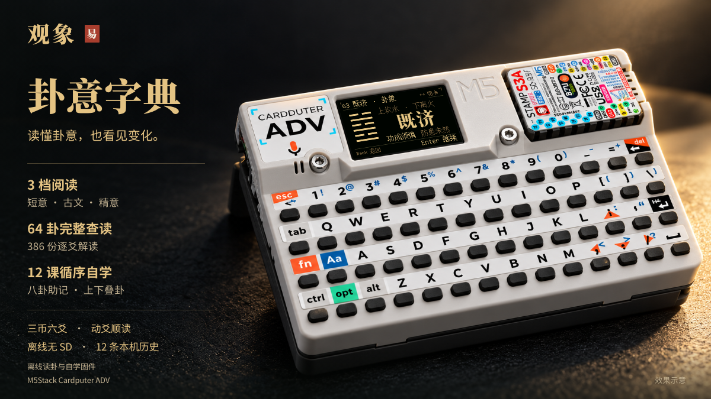
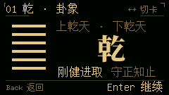
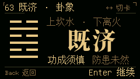
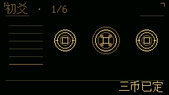

# GuanXiang

Offline three-coin I Ching and self-study firmware for **M5Stack Cardputer ADV**, with a dark landscape interface, warm gold text, and local reading history. Learn the eight trigrams and explore all 64 hexagrams without making a cast.

[Product page](https://lyzbn.github.io/GuanXiang-Firmware/en/) · Device illustration; screen UI rendered from the matching firmware and embedded fonts. [Image provenance](docs/media/README.md).

**v1.1.0-rc.2 prerelease** fixes skipped pages in the 64-hexagram catalogue: Left/Right now moves four entries, matching the visible page, and wraps at both ends. Three reading modes, continuous moving-line reading, self-study and 40px study-card names remain unchanged. [Download the prerelease](https://github.com/Lyzbn/GuanXiang-Firmware/releases/tag/v1.1.0-rc.2). Application source remains private. [中文](README.md)

## Screen preview

The 240 × 135 UI keeps the firmware's hexagram figures, 40px names and footer controls. These are static firmware-source renders, not hardware screenshots.

| Qian · large-name card | Jiji · large-name card |
| --- | --- |
|  |  |

| Coins rise | Coins in flight | Coins settled |
| --- | --- | --- |
|  |  |  |

## Three reading modes

Both primary and changed hexagrams support all three modes across the 64 hexagrams:

- **Summary / 短意**: the default, with two four-character modern lines per hexagram.
- **Insight / 精意**: four sections on each hexagram’s situation, principles, practical considerations and common misreadings, followed by commentary excerpts and sources.
- **Classical / 古文**: the complete judgment text, rather than a shortened two-line excerpt.

Expanded readings cover **64 hexagrams**, with **386 individual readings: 384 lines plus the special Use of Nine and Use of Six texts**. Each line separates explanation of the cited commentary from present-day reflections. Long text is split by section and page, with a 16px body and at most four lines per screen.

Canonical texts, excerpts from Wang Bi’s commentary and Kong Yingda’s subcommentary, and GuanXiang’s modern interpretations are labelled separately. The modern text was prepared by the project with AI assistance and checked against classical sources; it is not an existing translation by those commentators or a modern scholar. Modern books are recommendations for further reading, not permissions or endorsements. The classical collection includes 64 complete judgments, 64 Great Images, 384 line texts and 384 Small Images, plus the special texts and Small Images for Qian and Kun. It is not the complete Yi Zhuan collection.

See the [source and editorial notes](TEXT_SOURCES.md), [all 64 expanded and 386 line/special-text readings with sources](readings.json), and the [twelve lessons, diagrams and 64 Great Images](study-content.json).

Press **I** on the home screen to open settings. **T** cycles and saves the default reading mode there. On a hexagram reading page, **T** changes only the current reading session and returns to page one; it does not save a new default. Opening a history entry applies the saved default and does not create another entry.

Use **Up/Down** to turn pages, or **Enter** to advance. Moving-line reading finishes every page of each card, then follows **line text → Small Image → Insight → next moving line → changed hexagram**. The final moving line leads directly to the changed hexagram. When all lines of Qian or Kun move, the special Use of Nine or Use of Six is completed first. Left/Right still switches cards directly.

## Learn the 64 hexagrams

Press **L** on the home screen. Study does not require a cast or create a history entry.

1. **Twelve foundation lessons** introduce yin and yang, reading lines from bottom to top, and the eight trigrams through traditional mnemonics and diagrams.
2. **Combine two trigrams** to see the resulting six-line figure, name and number. Li below Kan forms Jiji; reversing them forms Weiji. Up/Down selects the upper or lower trigram, and Left/Right changes it.

3. **Explore all 64 in the conventional order**, with Left/Right moving four entries and wrapping at both ends. Read the judgment, Great Image, Insight, six lines and sources using the same material as casting. Returning preserves the catalogue or combination position.

Each study card uses a **40px name beside the hexagram figure**, with upper/lower trigram labels above and two short summary lines below. The layout supports all 64 hexagrams.

## Casting and history

Press Enter once to spin and again to toss for each line: twelve presses complete a six-line cast. Explore the primary hexagram, moving lines and changed hexagram. Choose relaxed or snappy timing, sound and reduced motion independently. An optional intention accepts up to 24 ASCII bytes; local history holds twelve entries. No network or microSD is needed.

The firmware interface and reading texts are in Chinese; this English guide does not imply an English firmware interface.

## Installation assets

| Installation | Flash address | Existing history and settings |
| --- | --- | --- |
| Complete merged image | `0x0` | Resets NVS; preserve important records first |
| Compatible GuanXiang application update | `0x10000` | Does not write NVS; requires matching partitions and app0 boot selection |

Follow the prerelease package instructions and checksums. Existing history and settings formats remain unchanged. This rc.2 device check confirmed normal startup, retained history/settings, forward and backward catalogue wrapping, and opening hexagram 64 and returning to the correct page. Full casting, exactly one new history entry, and USB/battery cold starts were accepted on rc.1 and were not repeated this round. Assets, checksums and relink materials are on the [download page](https://github.com/Lyzbn/GuanXiang-Firmware/releases/tag/v1.1.0-rc.2).

## Validation status

The current **v1.1.0-rc.2 prerelease** retains source-version metadata `1.1.0-dev`. Pagination fix `96057ad` was merged as `935194f`; fixed-source CI `40195260690` passed on same-tree checkout `fd68d201`. All **239,345 native regression checks** passed. Study checks cover **5,362 layouts and 34,342 bounds**, with zero errors. The selected Linux application is **1,567,664 bytes**; its digest and version-specific evidence are in [VALIDATION.md](VALIDATION.md).

This build passed app-only writing, independent Flash verification, NVS preservation and a 20-second serial boot smoke test. Targeted catalogue device acceptance passed. Matching relink and modified-framework rebuilding also passed; native Linux verification of the release assets is recorded separately. Earlier full-reading, cold-start and relink results are not treated as rc.2 results; the [validation record](VALIDATION.md) separates current and historical checks. The [release notes](RELEASE_NOTES_v1.1.0-rc.2.md) describe the fix and downloads.

## Release materials

For rc.1 users: [download the 2026-10-20 license supplement](https://github.com/Lyzbn/GuanXiang-Firmware/releases/download/v1.1.0-rc.1/GuanXiang-v1.1.0-rc.1-License-Supplement-20261020.zip) alongside the rc.1 Relink.zip; it adds the complete Adafruit TCA8418 BSD notice without changing firmware or the original release assets.

rc.2 materials are on the [release page](https://github.com/Lyzbn/GuanXiang-Firmware/releases/tag/v1.1.0-rc.2); its packages include the complete Adafruit TCA8418 BSD notice. See the [installation guide](INSTALL.md), [third-party notices](THIRD_PARTY_NOTICES.md) and [font sources](FONT_SOURCES.md).
